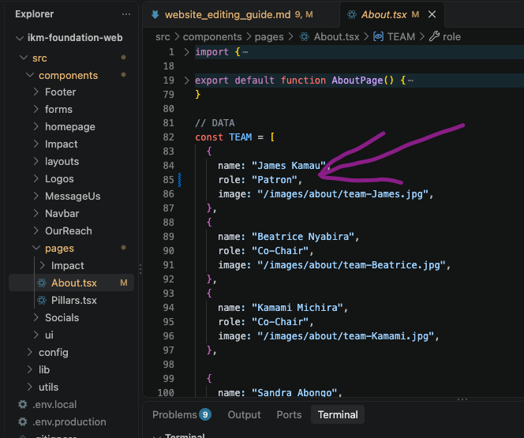
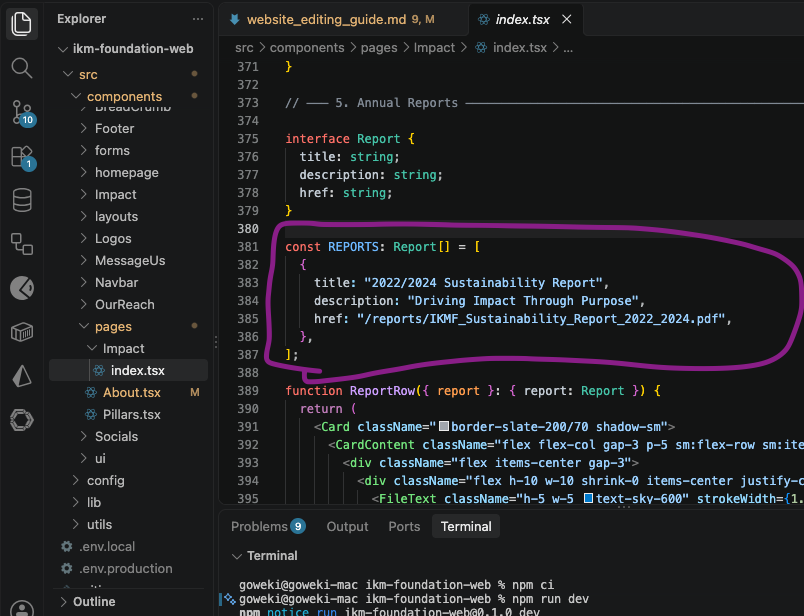

# Website Editing Guide

This guide covers updating team details and adding impact reports to the website.

## Prerequisites

- [VS Code](https://code.visualstudio.com/) installed
- Basic GitHub and Git knowledge
- [Repository link](https://github.com/goweki/ikm-foundation-web)

---

## Step 1: Clone the Repository & Open in VS Code

1. Open your terminal and clone the repository:
   ```bash
   git clone <repository-link>
   ```
2. Open the project folder in VS Code.
3. Install dependencies and run the development server:
   ```bash
   npm ci
   npm run dev
   ```
4. Open `http://localhost:3000` in your browser to view the site.


---

## Step 2: Handle Assets (Photos & Reports)

1. Drop the new **CSR Committee Photo** into the public assets folder (e.g., `public/images/team/`).
2. Drop the new **Sustainability Report PDF** into the documents folder (e.g., `public/docs/reports/`).


---

## Step 3: Update the Team Section

1. Locate the component with the data (team component: `src/components/pages/About.tsx`).
2. Open the file and find James's entry to update his title.

```json
// Example Data Structure
{
  "name": "James Smith",
  "title": "Patron", // Updated from Managing Partner
  "image": "/images/team-James.jpg"
}
```



### Add CSR Committee Member

- Add a new object to the team array with the new member's details and the uploaded photo path, setting their appropriate title.

```json
{
  "name": "Jane Doe",
  "title": "CSR Committee Member",
  "image": "/images/team/csr-new-member.jpg"
}
```

---

## Step 4: Update the Impact Section (Annual Reports)

1. Locate the Impact component: `src/components/pages/Impact/index.tsx`.
2. Add a new entry for the Sustainability Report, linking to the PDF file you placed in the `public` folder.

```json
// Example Reports Array
{
  "title": "2022/2024 Sustainability Report",
  "description": "Driving Impact Through Purpose",
  "href": "/reports/IKMF_Sustainability_Report_2022_2024.pdf"
}
```



---

## Step 5: Test Locally

1. Check your local browser preview (`http://localhost:3000`) to confirm:
   - James's title reads "Patron".
   - The new CSR Committee member is visible with their photo and title.
   - The Sustainability Report is downloadable/accessible under the Annual Reports section.

## 

## Step 6: Commit and Push Changes

1. Stage your changes in git:
   ```bash
   git add .
   ```
2. Commit with a clear message:
   ```bash
   git commit -m "Update team titles, add CSR member, and add sustainability report"
   ```
3. Push to GitHub to deploy:
   ```bash
   git push origin main
   ```

_[Screenshot Placeholder: Terminal showing successful git push]_
